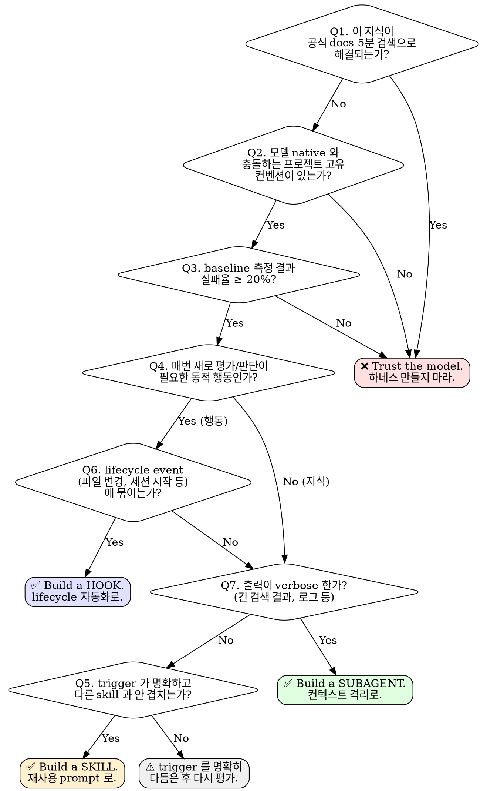

# 01 — Build vs Trust 프레임워크

> **무엇을 하네스(skill/subagent/hook)로 만들고, 무엇은 모델 native 지식에 맡길 것인가**
> 
> 이 보고서의 척추 문서. 다른 deep-dive 들은 "만들기로 결정한 후"의 작성 원리를 다루지만, 이 문서는 그 **앞단의 분기**를 다룬다.

---

## 0. 한 줄 요약

> **"Claude는 이미 매우 똑똑하다"는 Anthropic의 공식 1번 원칙이다. 일반 코딩 지식, 표준 API 사용법, 잘 알려진 라이브러리 패턴 등 모델 native 영역에 skill 을 덧붙이면 ① description budget 잠식 ② SKILL.md 25k token 공유예산 잠식 ③ 잘못된 trigger 위험 ④ 유지보수 부담만 얻는다. Skill 은 *모델이 모르는 것* 또는 *모르면 안 되는 프로젝트 고유 컨벤션* 에만 쓴다.**

근거: [agent-skills-best-practices.md §Core principles](../raw/anthropic/agent-skills-best-practices.md) — `"Default assumption: Claude is already very smart. Only add context Claude doesn't already have. Challenge each piece of information: 'Does Claude really need this explanation?' 'Can I assume Claude knows this?' 'Does this paragraph justify its token cost?'"`

---

## 1. 문제 정의 — "model already knows" 영역에 skill 을 만들면 발생하는 비용

### 1.1 비용 4종

| 비용 | 메커니즘 | 정량 근거 |
|---|---|---|
| **Description tax** | 모든 skill 의 `name + description` 은 세션 시작 시 system prompt 에 항상 로드된다. | description 1024 chars cap, name+description+when_to_use 합산 1536 chars cap. 전체 skill 목록 budget = context window 의 **1%** (기본값). 초과 시 "least recently invoked" 부터 잘림. ([claude-code-skills.md §Skill descriptions are cut short](../raw/anthropic/claude-code-skills.md)) |
| **Invoke-time context tax** | skill 이 trigger 되면 SKILL.md 전체가 단일 메시지로 context 에 들어가고 **세션 끝까지 남는다 (re-read 안 됨)**. | 권장 limit "500 lines / under 5000 tokens". Auto-compaction 후에도 "첫 5000 tokens 보존, 전체 skill 합산 25k token budget". 오래된 skill 은 drop. ([claude-code-skills.md §Skill content lifecycle](../raw/anthropic/claude-code-skills.md)) |
| **False-trigger risk** | description 이 모델 native 영역과 겹치면 모델이 잘못 trigger 해서 더 좋은 답을 가린다. | community: *"the single most important line in the description is the exclusion clause: Do NOT use for..."* ([community-blog-skill-authoring-patterns.md §Exclusion Clause Pattern](../raw/community/community-blog-skill-authoring-patterns.md)) |
| **Maintenance drift** | 모델 지식은 모델 버전과 함께 진화하지만 skill 내용은 정적. 모델이 이미 더 잘 아는 패턴을 가르치면 점점 outdated. | best-practices §"Avoid time-sensitive information" 권고 + community §"Known Gotchas Pattern" 의 "moving target" trade-off |

### 1.2 산술적 영향

- backend-ts (86 skills) 의 description 평균 200자 가정 → 86 × 200 = **17,200 chars 가 system prompt 에 상주**
- frontend-react-web (24 skills) 도 추가됨
- Opus 200k context 의 1% = 2000 chars description budget — **이미 초과** → 다수 skill description 이 잘리거나 표시 안 됨
- 잘리는 순서: "invoked least" 부터. 즉 **자주 안 쓰이는 skill 의 description 이 먼저 사라져 → 가장 발견되어야 할 niche skill 이 가장 먼저 보이지 않음** (역설)

→ **결론: skill 을 늘릴수록 새 skill 의 발견율이 떨어지는 음의 피드백.** "model native 와 겹치는" skill 을 줄이는 것이 **나머지 skill 의 효능을 회복시킨다**.

---

## 2. 모델 native 지식의 경계 — 무엇이 "이미 알고 있는" 것인가

### 2.1 객관화의 어려움

Anthropic 공식 문서는 "Claude is smart" 라고 단언하지만, *무엇이 smart 의 범위인지* 정량 정의는 없다. 대신 다음 3가지 휴리스틱이 raw 데이터 전반에 흩어져 있다.

### 2.2 3가지 휴리스틱 (raw 데이터 기반)

#### (H1) "공식 docs 5분 검색 테스트"

질문이 다음과 같은 형태라면 모델이 이미 안다고 가정한다:
- "공식 라이브러리 docs 의 첫 3개 페이지" 안에 답이 있는가? (e.g., React 의 `useEffect`, Next.js routing, pdfplumber 사용법)
- StackOverflow 검색 5분 내 표준 답이 있는가?

근거: [agent-skills-best-practices.md §Concise is key](../raw/anthropic/agent-skills-best-practices.md) 의 PDF 예시 — pdfplumber 사용법은 "Claude 가 안다고 가정" 하고 50토큰으로 압축하라고 명시. 반면 "어떤 라이브러리를 쓸지" 의 결정은 명시.

#### (H2) "모델 버전과 함께 진화하는 영역인가"

- **Yes (native 영역)**: 일반 React 패턴, REST API 디자인, SQL 쿼리 최적화, Python idiom, Git 워크플로우, TypeScript 타입 시스템
- **No (외부 컨벤션)**: 우리 프로젝트의 `StoragePort` 추상화, 특정 DB 스키마, 회사 보안 정책, 팀 commit message 컨벤션

근거: [agent-skills-overview.md §Key benefits](../raw/anthropic/agent-skills-overview.md) — *"Skills load on-demand and eliminate the need to repeatedly provide the same guidance"*. "repeatedly provide" 가 핵심: 매번 새로 가르쳐야 하는 것이 skill 대상.

#### (H3) "실패 빈도가 의미 있는 수준인가"

best-practices §Evaluation-driven development 에서 명시:

> 1. Identify gaps: Run Claude on representative tasks **without a Skill**. Document specific failures
> 2. Create evaluations: Build three scenarios that test these gaps
> 3. Establish baseline: Measure Claude's performance **without the Skill**
> 4. Write minimal instructions: Create just enough content to address the gaps

→ 즉 **"skill 없이 실패하는 사례"가 먼저 있어야 skill 을 만든다.** 추측이 아니라 측정 기반.

근거: [agent-skills-best-practices.md §Build evaluations first](../raw/anthropic/agent-skills-best-practices.md)

### 2.3 종합 정의 (이 보고서 권장)

> **모델 native 지식 = (H1 ∧ H2) ∨ (H3 의 baseline 이 80% 이상 성공)**
> 
> - (H1) 공식 docs 5분 검색으로 답 가능
> - (H2) 모델 버전 진화와 함께 자연스럽게 개선되는 영역
> - 또는 (H3) 측정한 baseline 실패율이 20% 미만
>
> 셋 중 어느 조건도 안 만족시키면 → build 검토 대상

---

## 3. Build vs Trust Decision Tree

> dot 소스. mermaid 등으로 변환 가능. raw 텍스트는 아래 표 형식으로도 본다.

### 3.1 7개 게이트 질문 — 상세

| # | 질문 | Yes 시 | No 시 | 근거 |
|---|---|---|---|---|
| Q1 | 이 지식이 공식 docs 5분 검색으로 해결되는가? | **TRUST** (만들지 마라) | Q2 로 | best-practices §"Claude is already very smart" |
| Q2 | 모델 native 와 충돌하는 프로젝트 고유 컨벤션 / 불변식이 있는가? | Q3 로 | **TRUST** | overview §"domain-specific expertise", best-practices §"Set appropriate degrees of freedom" |
| Q3 | skill 없이 baseline 측정 시 실패율 ≥ 20% 인가? | Q4 로 | **TRUST** | best-practices §"Build evaluations first" |
| Q4 | 매번 새로 평가/판단이 필요한 *동적 행동* 인가, 정적 *지식* 인가? | Q6 (행동) 로 | Q7 (지식) 로 | claude-code-skills.md §"Skill content lifecycle" — 동적 행동은 skill 의 정적 lifecycle 에 부적합 |
| Q5 | trigger description 이 명확하고 다른 skill 과 안 겹치는가? | **SKILL** build | **REWORK** | community §Exclusion Clause + Activation Metadata Pattern |
| Q6 | lifecycle event (파일 변경, 세션 시작, 도구 호출) 에 자연스럽게 묶이는가? | **HOOK** build | Q7 로 (행동이지만 lifecycle 외) | hooks-doc §Lifecycle |
| Q7 | 출력이 verbose 한가? (긴 검색 결과 / 로그 / 다수 파일 읽기) | **SUBAGENT** build | Q5 로 | sub-agents-doc §"a side task would flood your main conversation" |

### 3.2 결과 4분기

| 결과 | 의미 | 대표 사례 |
|---|---|---|
| **TRUST** | 만들지 마라. 모델에 맡겨라. | "React useState 사용법", "git commit 메시지 컨벤션 (일반)", "REST API URL 디자인" |
| **HOOK** | 결정론적 lifecycle 자동화로. | "PostToolUse 후 자동 lint", "SessionStart 시 git status injection", "PreToolUse 로 destructive command 차단" |
| **SUBAGENT** | 컨텍스트 격리 + 결과만. | "테스트 전체 실행 후 실패만 보고", "3개 모듈을 병렬 리서치", "권한 제한된 read-only DB 쿼리" |
| **SKILL** | 재사용 가능한 prompt + 지식. | "프로젝트 고유 StoragePort 추상화 결정 워크플로우", "회사 코드 리뷰 체크리스트", "특정 audit 절차" |
| **REWORK** | trigger 재설계 후 재평가. | "다른 skill 과 겹치는 description", "exclusion clause 누락" |

---

## 4. 분기 매트릭스 — Skill vs Subagent vs Hook

세 하네스 타입은 자주 헷갈리지만 *제어하는 축*이 다르다.

| 축 | Skill | Subagent | Hook |
|---|---|---|---|
| **누가 부르는가** | user (`/name`) 또는 model auto-invoke | model 이 delegate, 또는 `--agent` | **시스템이 자동** (이벤트 trigger) |
| **무엇을 제공하는가** | 재사용 prompt + 정적 지식 + 보조 파일 | 격리된 실행 컨텍스트 + 권한 제한 | 결정론적 부수효과 (block/inject/log) |
| **언제 로드되는가** | metadata: 항상 / body: invoke 시 1회 | 매 spawn 마다 fresh context | 이벤트 발생 시 매번 |
| **모델 판단 개입** | **있음** (skill 안에서 LLM 이 해석/적용) | **있음** (subagent 도 LLM) | **없음** (shell/HTTP/MCP 호출 결과만) |
| **컨텍스트 영향** | main context 에 누적 | main context 격리 (요약만 returning) | additionalContext 로 inject 또는 차단 |
| **재현성** | 모델 해석에 따라 변동 | subagent 해석에 따라 변동 | **결정론적** |
| **권한** | `allowed-tools` 사전승인 (실제 제한은 permission rules) | `tools` allowlist + `permissionMode` | n/a (시스템 동작) |
| **대표 use case** | 프로젝트 컨벤션 가르치기 | verbose 리서치, 격리 실행 | lint 자동화, 보안 차단, context injection |

### 4.1 같은 작업을 세 가지로 풀 때

예시: "신규 API endpoint 추가 시 zod 스키마 검증을 강제하고 싶다"

| 방식 | 구현 | 장점 | 단점 |
|---|---|---|---|
| **Skill** (api-validation) | SKILL.md 에 "API 추가 시 zod 사용" 안내 + 예시 | 학습성. 모델이 *왜* 인지 이해 | 모델이 무시할 수 있음. compaction 후 떨어질 수 있음. *skill content lifecycle 의 함정* |
| **Subagent** (api-builder) | api 추가 작업을 통째로 subagent 에 위임. zod 강제 prompt | 격리. main context 안 더러움 | 매번 cold-start. brief 비용. mid-task 통신 불가 |
| **Hook** (PostToolUse on Write 매처 = `src/api/*.ts`) | 파일 저장 후 `validate-zod.sh` 가 zod import 없으면 차단 | **결정론적**. 모델이 잊어도 시스템이 강제 | 학습성 0. 모델은 *왜* 막혔는지 에러 메시지로만 학습 |

→ **권장 조합**: Hook (강제) + Skill (학습성) 의 hybrid. Skill 에서 "이 영역은 PostToolUse hook 이 zod 를 강제한다" 를 명시. Subagent 는 이 경우 과한 격리.

### 4.2 Skill ↔ Subagent 분기의 공식 가이드

[claude-code-subagents.md §Choose between subagents and main conversation](../raw/anthropic/claude-code-subagents.md) 가 직접 명시:

> **Use the main conversation when**: task needs frequent back-and-forth / multiple phases share significant context / quick targeted change / latency matters
> 
> **Use subagents when**: task produces verbose output you don't need in main context / want to enforce specific tool restrictions / work is self-contained and can return a summary
>
> **Consider Skills instead when you want reusable prompts that run in the main conversation context.**

→ 한 줄 분기: **"main context 에 결과가 남아야 하는가"** Yes → Skill, No → Subagent.

---

## 5. 안티 패턴 — "이걸 skill 로 만들면 안 된다" 의 6가지 즉시 사례

(각각은 [`05-anti-patterns.md`](05-anti-patterns.md) 에서 깊게 다룬다. 여기선 요약만.)

1. **"general React patterns" skill** — 모델 native 와 정확히 겹침. (Q1 위반)
2. **"how to write SQL queries" skill** — 모델 native. 단, "우리 회사 SQL 컨벤션" 이면 OK.
3. **"git commit message format" skill (일반)** — Conventional Commits 는 모델 native. "우리 회사 sub-scope 규칙" 이면 OK.
4. **너무 짧은 description** — "Helps with documents" 류. trigger 불가. (best-practices §"Writing effective descriptions")
5. **All-caps imperative 만 가득한 skill** — community §"Explain-the-Why Pattern" 위반. 모델이 edge case 에서 over/under-apply.
6. **skill 안에 동적 매번-평가 절차** — 첫 invoke 후 content 가 stale 됨에도 re-read 안 됨. hook 으로 가야 할 작업.

---

## 6. 외부 출처 매핑 — 각 결정 기준의 근거

각 결정 기준이 raw 데이터의 어느 부분에 근거하는지 명시 (검증용).

| 결정 기준 | raw 출처 | 핵심 인용 |
|---|---|---|
| "Claude is already smart" 1번 원칙 | [agent-skills-best-practices.md L27-33](../raw/anthropic/agent-skills-best-practices.md) | `"Default assumption: Claude is already very smart. Only add context Claude doesn't already have."` |
| description 1024 chars cap | [agent-skills-overview.md L177-186](../raw/anthropic/agent-skills-overview.md), [agentskills.io spec](../raw/codex-openai/agents-md-spec.md) | `"description: Maximum 1024 characters"` |
| description budget 1% of context | [claude-code-skills.md L402-408](../raw/anthropic/claude-code-skills.md) | `"The budget scales at 1% of the model's context window. When it overflows, descriptions for skills you invoke least are dropped first."` |
| skill content 25k token budget | [claude-code-skills.md L226-232](../raw/anthropic/claude-code-skills.md) | `"Re-attached skills share a combined budget of 25,000 tokens. Claude Code fills this budget starting from the most recently invoked skill, so older skills can be dropped entirely after compaction."` |
| skill 한 번 로드되면 re-read 안 됨 | [claude-code-skills.md L226-232](../raw/anthropic/claude-code-skills.md) | `"the rendered SKILL.md content enters the conversation as a single message and stays there for the rest of the session. Claude Code does not re-read the skill file on later turns."` |
| Skill vs Subagent 분기 | [claude-code-subagents.md L348-361](../raw/anthropic/claude-code-subagents.md) | `"Consider Skills instead when you want reusable prompts that run in the main conversation context."` |
| Hook = lifecycle 자동화 | [claude-code-hooks.md L14-22](../raw/anthropic/claude-code-hooks.md) | `"Hooks are user-defined shell commands... that execute automatically at specific points in Claude Code's lifecycle."` |
| Exclusion clause "single most important line" | [community-blog-skill-authoring-patterns.md L38-46](../raw/community/community-blog-skill-authoring-patterns.md) | `"This is called 'the single most important line in the description' by practitioners"` |
| Explain-the-Why (all-caps anti) | [community-blog-skill-authoring-patterns.md L93-101](../raw/community/community-blog-skill-authoring-patterns.md) | `"All-caps rules (ALWAYS, NEVER, MUST) without context leave Claude following the letter while missing edge cases or over-applying rules in situations requiring judgment."` |
| Build evaluations first | [agent-skills-best-practices.md L454-476](../raw/anthropic/agent-skills-best-practices.md) | `"Create evaluations BEFORE writing extensive documentation. This ensures your Skill solves real problems rather than documenting imagined ones."` |
| Cross-vendor 표준 (skill 포맷) | [agents-md-spec.md L216-231](../raw/codex-openai/agents-md-spec.md) | agentskills.io 표준 — Claude, Codex, Cursor, Gemini, Copilot 등 40+ 채택 |

---

## 7. hibye-plugins 적용 가이드 — 기존 자산 평가 절차

이 framework 를 적용할 때 추천하는 audit 절차:

1. **목록화**: `find plugins/*/skills -name SKILL.md | xargs grep -H "description:" | head` 로 모든 description 수집
2. **그룹 분류**: 각 skill 을 다음 3 범주로 분류
   - (a) **모델 native + 일반 패턴 가르침** — 즉시 deprecate 후보
   - (b) **프로젝트 고유 컨벤션 / 불변식** — 유지
   - (c) **lifecycle 자동화 가능** — hook 으로 마이그레이션 후보
3. **Decision Tree 적용**: 각 skill 을 §3 의 7-게이트에 통과시켜 4분기 결과 도출
4. **우선순위**: TRUST 분기 = 비용 가장 큰 cleanup (즉시), REWORK = 다음 sprint, HOOK 마이그레이션 = 별도 작업

[`synthesis-report.md`](../synthesis-report.md) §6 에 backend-ts 의 대표 3개 skill 을 dry-run 한 사례가 있다.

---

## 8. 결정 기준의 임계값 — 사용자 합의가 필요한 영역

이 framework 의 정량적 임계값은 raw 데이터에 명시되지 않은 **저자 권고**다. 운영하면서 사용자(레포 운영자)가 조정할 영역:

| 임계값 | 본 보고서 권장 | 조정 가능 범위 |
|---|---|---|
| (Q1) "공식 docs 검색 시간" | 5분 | 3–10분 |
| (Q3) "baseline 실패율 threshold" | 20% | 10–40% |
| (Q7) "verbose 의 정의" | 5+ tool call 또는 50+ 파일 읽기 | 프로젝트 의존 |
| description 평균 길이 | 200 chars | 150–400 |
| SKILL.md 길이 cap | 500 lines (Anthropic 공식 권고) | 200 lines (frontend-react-web 스타일) ~ 1500 lines (backend-ts 스타일) |

특히 **SKILL.md 길이 cap 의 두 학파**:
- **Anthropic 공식**: "Under 500 lines for optimal performance"
- **backend-ts 실전**: 1000–2000 lines (12단계 패턴, invariants + workflows + audit + matrices 모두 포함)

→ 보고서는 *"information density per token"* 으로 평가 권장. backend-ts 의 긴 skill 이 정당화되려면 *모든* 줄이 모델 native 와 겹치지 않는 정보를 담아야 함. 다음 deep-dive 문서 [`02-skills-deep-dive.md`](02-skills-deep-dive.md) §"길이 가이드라인" 참조.

---

## 9. 끝맺음 — 이 framework 가 의도하지 않는 것

- ❌ **"skill 을 줄이라"는 처방이 아님**. "model native 와 겹치는 skill 만 줄이라"는 처방. 프로젝트 고유 자산은 늘려도 됨.
- ❌ **"hook 이 항상 우수하다"가 아님**. hook 은 결정론적이라 학습성이 0. 모델이 *왜* 막혔는지 모름. 학습성이 필요하면 skill + hook 의 hybrid.
- ❌ **"subagent 가 컨텍스트 만능"이 아님**. subagent 는 cold-start cost 가 있어 brief 가 핵심. 짧은 작업엔 main context.

다음으로 읽을 문서:
- [`02-skills-deep-dive.md`](02-skills-deep-dive.md) — 만들기로 결정한 skill 의 작성 원리 14 패턴
- [`03-subagents-deep-dive.md`](03-subagents-deep-dive.md) — subagent 분리 비용/이득 상세
- [`04-hooks-deep-dive.md`](04-hooks-deep-dive.md) — hook 자동화의 강제력
- [`05-anti-patterns.md`](05-anti-patterns.md) — 만들면 안 되는 사례 카탈로그
